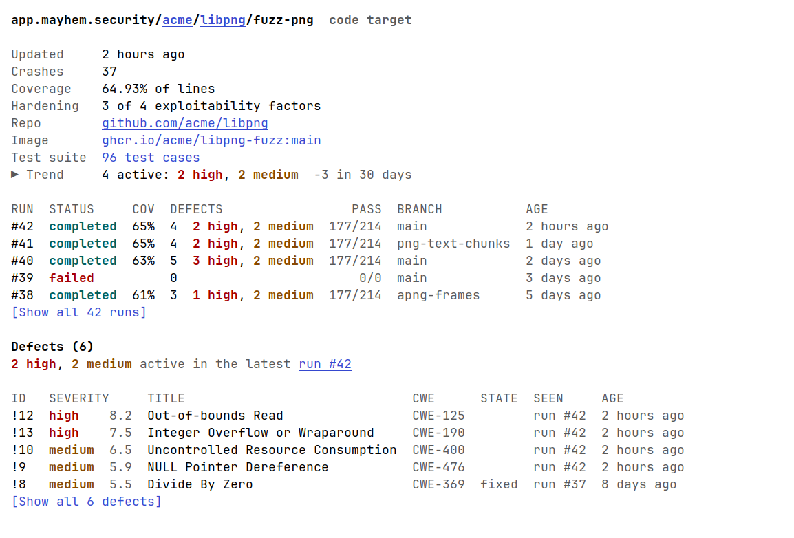
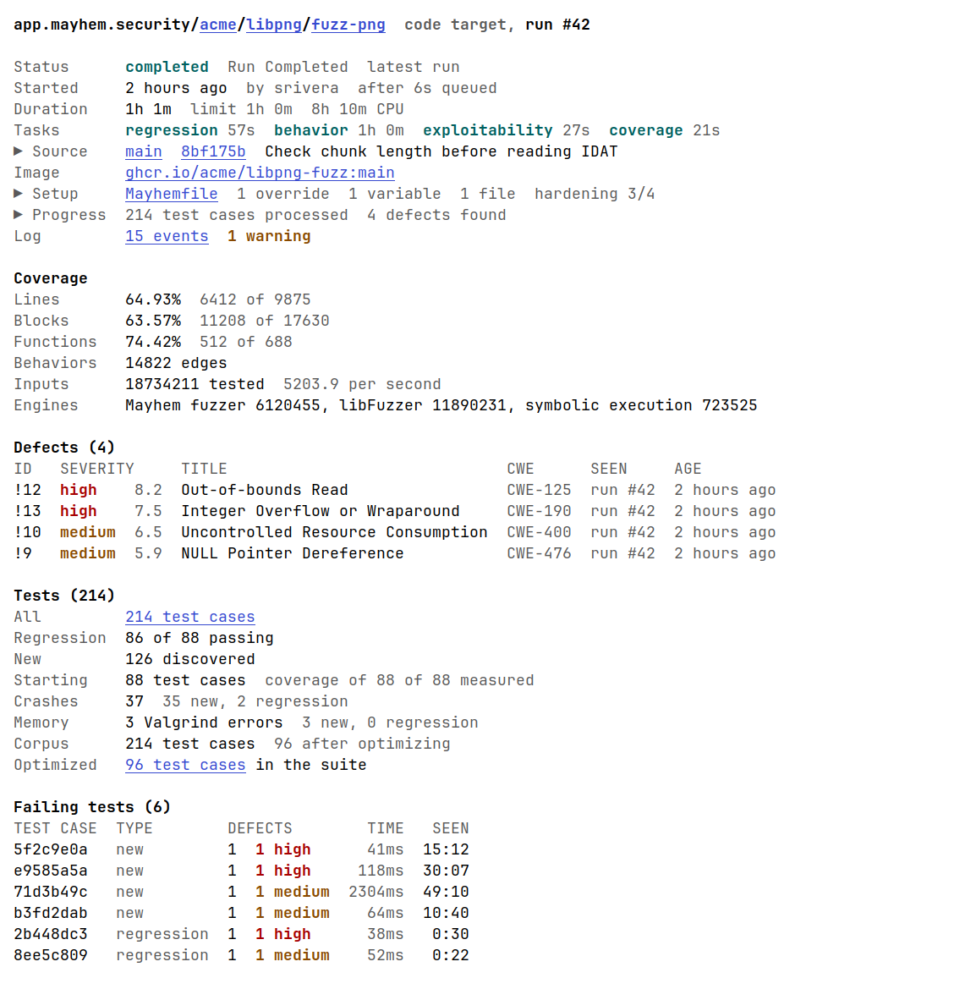

# mayhem.el

An Emacs client for [Mayhem](https://mayhem.security/) ([app.mayhem.security](https://app.mayhem.security)), built with [vui.el](https://github.com/d12frosted/vui.el).

Early work in progress.  You can browse your workspaces, projects,
targets, runs, defects and test cases, read-only, and edit Mayhemfiles
with Flymake checking them.

A target, and one of its runs:





[docs/screenshots](docs/screenshots/README.md) shows every page, drawn
from made-up data.

## Requirements

- Emacs 29.1 or later, built with SQLite (`(sqlite-available-p)`)
- [vui.el](https://github.com/d12frosted/vui.el)
- A Mayhem API token in `~/.config/mayhem/mayhem`, as written by the
  Mayhem CLI's `mayhem login`.  mayhem.el reads its `url` and `token`
  and stores no credentials of its own.
- The Mayhem CLI on your `PATH`, only to check Mayhemfiles.

## Installation

mayhem.el is not on MELPA yet.  Install it, and vui.el, from Git:

```elisp
(package-vc-install "https://github.com/d12frosted/vui.el")
(package-vc-install "https://github.com/razzmatazz/mayhem.el")
```

`mayhem-jump` works anywhere, so you may want it global:

```elisp
(keymap-global-set "C-c m" #'mayhem-jump)
```

## Getting started

`M-x mayhem` opens the dashboard: who you are logged in as, and the
workspaces (users and orgs) whose projects you can see.  From there,
RET on anything opens its page.  `C-c C-j` jumps straight to a
workspace, project or target by name.

Pages show cached data at once and refetch in the background;
`:loading` in the mode line means a fetch is under way.  If one fails,
say because your token expired, the error shows in the header line.

### Keys

| Key | Command |
|---|---|
| `RET` | open what is at point, or switch to the tab at point (also `o` under Evil) |
| `S-RET` | open it in another window (also `O` under Evil) |
| `g` | refresh the page (`gr` under Evil) |
| `C-c C-j` | jump to a workspace, project or target by name |
| `C-c C-o` | open this page in the web app, in a browser |
| `C-c C-v` | switch the page's view, say a test case's bytes between hex and text |
| `F` | filter a list of every defect, run or test case |
| `w` | save the test case at point to a file (test suite page) |
| `q` | go back to the previous page |

## Pages

Each is pictured in [docs/screenshots](docs/screenshots/README.md).

### Workspace and project

A **workspace** lists its projects and their targets.

A **project** shows its repository, remaining and fixed defects, how
many targets pass their tests, a defect trend chart, and its targets
(active and archived tabs), each with what its latest run found.

### Target

- Its latest run: what it found, its line coverage, hardening,
  repository, image and test suite.
- Its defect trend over 30 days, folded in the header as `▶ Trend`.
- Its five latest runs, each with its coverage, defects, tests passed,
  edges covered and inputs tested per second, and branch.
- Its five most severe defects.

`[Show all 42 runs]` and `[Show all 6 defects]` open a page of every
one, tallied (`2 high, 3 medium, 1 low`) and filtered
with `F`: defects by severity, CWE or state, runs by status or branch.

### Run

The header says how the run went: its status, when it started and how
long it waited in the queue, how long it ran against its time limit
and its CPU time, its source (repository, branch, commit and parent
commit, and the CI build that started it), its image, and each task
(regression, exploitability, behavior, coverage), coloured by how it
went, with how long it took.  Lines too wide to fit, such as what the
CLI overrode, the environment it added and the files sent, are folded.

- `Mayhemfile` opens the Mayhemfile it was started with, read-only
  (see [Mayhemfile mode](#mayhemfile-mode)).
- `Log` opens the run's event log, a page of its own; the field counts
  its errors and warnings.

A code run then shows:

- **Progress**: a chart of test cases processed and defects found over
  time, as in the web app; folded in the header once the run is done.
- **Coverage**, with the inputs each engine tested.
- **Defects**, the first 10 until `Show all` lists the rest.
- **Tests**: counts, crashes, Valgrind errors, the corpus and the
  failing test cases, the first 10 likewise.

An API run shows its endpoints instead.

A run that is still going, and its log, refresh themselves every 10
seconds.

### Defect

Severity, CWE, the commit of the run that saw it, description and
evidence.  For a crash, the test cases that hit it (RET opens one), and
one's reproducer and backtrace; for an API defect, the request,
response and stack trace.

### Test suite, test cases and test case

The **test suite** is the optimized set of a target's test cases at
the end of a run, newest first, each with its size, source, age and
first bytes.  RET on `Test suite` on the target page, or on `Optimized`
in a run's Tests, opens it.  A finished run's suite is downloaded once
and kept.

**Test cases** lists every test case of a run, the ones the suite
dropped too, each with its status, type, defects, source and execution
time, filtered by status, type or source.  RET on `All` in a run's
Tests, or on the run's count on its test suite page, opens it.

A **test case** shows its defects, how to reproduce it, its bytes, the
target's standard output and standard error, each under its own
heading, and the backtrace.  libFuzzer's own lines are greyed, so the
target's stand out.  Its bytes and each stream show their first 12
lines; `[Show all N lines]` grows them in place.

### On every page

Repositories, branches, commits and CI builds are links, shown with
the repository's host (`github.com/owner/name`); RET follows them with
`browse-url`.  Branches and commits link on GitHub, GitLab and
Bitbucket.

A project's defect trend covers the last 12 months, 3 months, 30 days,
7 days or 24 hours; pick one with RET.  A target's covers 30 days.
Only members of a workspace can see its trends; others' pages leave the
trend out.  Hover over a chart, or leave point on it, to see its
numbers; timestamps show the exact time, and short counts (`5.2k`)
the exact number, the same way.

Pages follow their window's width up to `mayhem-max-width` columns:
in a narrow window, titles and names are cut with `…` and descriptions
and charts narrow, so rows keep to one line.

## Mayhemfile mode

`mayhem-mayhemfile-mode` opens files named `Mayhemfile` or
`*.Mayhemfile`, and a run's Mayhemfile.  It derives from your YAML mode
and checks the file with Flymake through `mayhem validate`
(`mayhem-mayhemfile-validate-command`), marking each key it names.

## Web links

Links to the web app open in mayhem.el wherever Emacs follows a link,
for example:

- `https://app.mayhem.security/owner/project/target/1` (a run)
- `...?defect=N` (a defect)
- `.../1/tests?testcase=SHA` (a test case)

Links mayhem.el has no page for still go to the browser.
`M-x mayhem-browse-url` opens a pasted link.

## Customization

| Option | Default | What it does |
|---|---|---|
| `mayhem-open-urls` | `t` | open web app links in mayhem.el |
| `mayhem-max-width` | `100` | most columns a page takes; nil for the whole window |
| `mayhem-run-refresh-interval` | `10` | seconds between refreshes of a running run |
| `mayhem-sync-fresh-for` | `30` | seconds a page's data is reused before refetching |
| `mayhem-sync-settled-for` | a day | the same, for data that no longer changes: finished runs, defects, test cases |
| `mayhem-mayhemfile-validate-command` | `mayhem validate --no-docker` | checks a Mayhemfile; nil turns checking off |
| `mayhem-config-file` | `~/.config/mayhem/mayhem` | where your token is |
| `mayhem-sync-directory` | `~/.emacs.d/mayhem/` | where the cache is kept; deleting it is safe |

`g` always refetches, however fresh the data is.  A workspace's
targets, which change rarely, are reused for 5 minutes.

## Troubleshooting

`M-x mayhem-doctor` reports, as text to paste into a bug report:

- which files are loaded, and whether a compiled one is older than its
  source;
- the cache's size, free space and largest entries;
- how long `mayhem-jump` takes to open, and the targets it hides
  because their project is missing, by project.

It names your workspaces, projects and targets, but not your token.

## Development

See [CONTRIBUTING.md](CONTRIBUTING.md) and [AGENTS.md](AGENTS.md).

`make ci` compiles, lints (`checkdoc`, `package-lint`,
`check-declare`, and `elisp-lint` for indentation, whitespace and
100-column lines) and tests with [Eldev](https://github.com/emacs-eldev/eldev),
and runs [melpazoid](https://github.com/riscy/melpazoid) as MELPA's
reviewers do, each in an isolated Docker or Podman container: your
user, no capabilities, no network but to fetch, the tree read-only but
`.eldev/` and `docs/screenshots/`.  melpazoid is pinned by
`MELPAZOID_COMMIT` in the `Makefile`; any finding fails it, and its
reports land in `.ci/`.  `make ci` runs on Emacs 31.1 (`EMACS=29.1`
picks another); `make ci-all` runs 29.1, 30.2 and 31.1 at once, as
GitHub Actions does.

`make screenshots` redraws [docs/screenshots](docs/screenshots/README.md)
from made-up data.  `make bench` times `mayhem-jump`'s search on a
large made-up cache (`make bench BENCH_TARGETS=8000` for another size).

The API's own spec is in
[docs/mayhem-openapi.json](docs/mayhem-openapi.json); check it first for
endpoints and fields.  It lacks many that the web app and the CLI use:
[docs/mayhem-api-usage.md](docs/mayhem-api-usage.md) lists the ones
mayhem.el uses, and how to find others.  How pages cache and refetch
is in [docs/mayhem-sync.md](docs/mayhem-sync.md).
