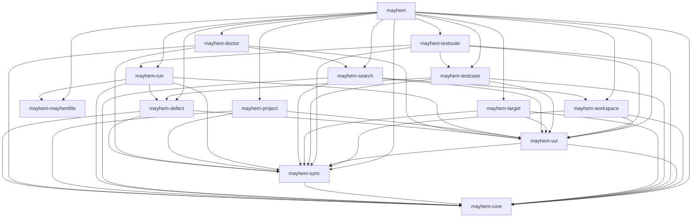

# Architecture

mayhem.el is split into one file per module.  `mayhem.el` is the
package's main file: it holds the `;;;###autoload` entry points and
requires every other module, so whatever a user runs has all of them
loaded.

## Layers

From the bottom up:

- **Standalone**: `mayhem-mayhemfile`, the major mode for Mayhemfiles,
  requires no other module: it is used on files from disk as well as
  on a run's page.
- **`mayhem-core`**: the Mayhem REST API.  It reads the URL and token
  from the Mayhem CLI's config, fetches asynchronously, and shapes what
  the API returns, in pure functions where it can, so they are tested
  without a server.  It also maps web app links to pages, `(KIND
  ARGS...)` such as `(run OWNER PROJECT TARGET NUMBER)`, and back.
- **`mayhem-sync`**: the local SQLite store pages read from, and the
  fetching that fills it.  It knows how to fetch, store and refresh a
  resource, not what any resource is; each is defined beside the page
  that shows it.  See [mayhem-sync.md](mayhem-sync.md).
- **`mayhem-vui`**: what every page shares, on top of vui.el: the base
  mode `mayhem-page-mode` and its keys, opening pages in windows, and
  the parts pages are drawn from, such as headings, rows, links,
  tables, folds and list filters.
- **Pages**: one module per kind of page, or per group of related
  pages: `mayhem-workspace`, `mayhem-project`, `mayhem-target` (with
  its full lists of runs and defects), `mayhem-run` (with its log),
  `mayhem-defect`, `mayhem-testcase` and `mayhem-testsuite` (with a
  run's every test case).  A page requires the pages whose code it
  uses, as a run's page shows its defects with `mayhem-defect`'s.
  `mayhem-search` reads a workspace, project or target with completion
  for `mayhem-jump`, and `mayhem-doctor` writes the bug report
  `M-x mayhem-doctor` shows.
- **`mayhem`**: the entry points (`M-x mayhem`, the dashboard, and
  `mayhem-jump`), `mayhem-open`, and the handler that opens web app
  links in mayhem.el.

Requires must not form a cycle.  A page opens another through a
`(KIND ARGS...)` list: a row or link given one opens it with
`mayhem-open`, in `mayhem.el`, which calls that page's
`mayhem-KIND-open`.  So `mayhem-vui` names `mayhem-open` with a
`declare-function`, safe as `mayhem.el` has loaded every module by the
time anything runs, and a page need not require the pages it only
links to.

## Module graph

An arrow points from a module to one it requires.  A dashed one is a
`require` inside a function, run only when it is called.  Every
`require` is drawn, even one a longer path already implies, so the
graph shows each module's real dependencies.

<!-- module-graph -->

<!-- /module-graph -->

## Modules

<!-- module-list -->
| Module | What it is | Requires |
|---|---|---|
| `mayhem-core` | Mayhem API access for mayhem.el |  |
| `mayhem-defect` | Defect page for mayhem.el | `mayhem-core`, `mayhem-sync`, `mayhem-vui` |
| `mayhem-doctor` | Report on mayhem.el's code and store | `mayhem-core`, `mayhem-search`, `mayhem-sync`, `mayhem-vui` |
| `mayhem-mayhemfile` | Major mode for Mayhemfiles |  |
| `mayhem-project` | Project page for mayhem.el | `mayhem-core`, `mayhem-sync`, `mayhem-vui` |
| `mayhem-run` | Run page for mayhem.el | `mayhem-core`, `mayhem-defect`, `mayhem-mayhemfile`, `mayhem-sync`, `mayhem-vui` |
| `mayhem-search` | Find workspaces, projects and targets | `mayhem-core`, `mayhem-sync`, `mayhem-vui`, `mayhem-workspace` |
| `mayhem-sync` | Cache Mayhem data in a local SQLite store | `mayhem-core` |
| `mayhem-target` | Target page for mayhem.el | `mayhem-core`, `mayhem-sync`, `mayhem-vui` |
| `mayhem-testcase` | Test case page for mayhem.el | `mayhem-core`, `mayhem-defect`, `mayhem-sync`, `mayhem-vui` |
| `mayhem-testsuite` | Test suite page for mayhem.el | `mayhem-core`, `mayhem-run`, `mayhem-sync`, `mayhem-testcase`, `mayhem-vui` |
| `mayhem-vui` | Shared page parts for mayhem.el | `mayhem-core`, `mayhem-sync` |
| `mayhem-workspace` | Workspace page for mayhem.el | `mayhem-core`, `mayhem-sync`, `mayhem-vui` |
| `mayhem` | Emacs client for Mayhem | `mayhem-core`, `mayhem-defect`, `mayhem-doctor`, `mayhem-mayhemfile`, `mayhem-project`, `mayhem-run`, `mayhem-search`, `mayhem-sync`, `mayhem-target`, `mayhem-testcase`, `mayhem-testsuite`, `mayhem-vui`, `mayhem-workspace` |
<!-- /module-list -->

## Updating

`make update-architecture-md` rewrites the graph and the table above
from the `require` forms in the sources, read with Emacs's own reader,
and each file's title line.  `make lint` fails when they are out of
date.  The text around them is written by hand: change it when a
module's place in the layers changes.
