# Screenshots

What mayhem.el's pages look like, drawn from made-up data: the `acme`
workspace, its people and its hashes are all invented.  Each shot is
also kept as plain text, linked as *As text*, to read or diff.

`make screenshots` redraws them all; see [Updating](#updating).

## Dashboard

`M-x mayhem`: who you are, and the workspaces whose projects you see.

<!-- screenshot: (dashboard) -->
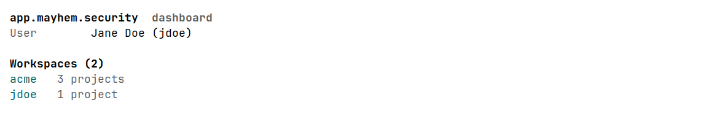

[As text](dashboard.txt)
<!-- /screenshot -->

## Workspace

A workspace's projects and their targets.

<!-- screenshot: (workspace "acme") -->
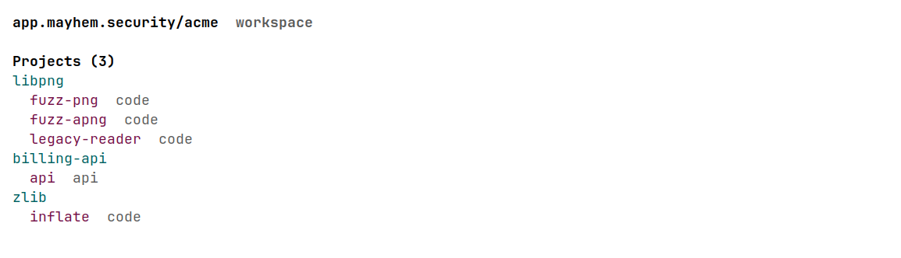

[As text](workspace.txt)
<!-- /screenshot -->

## Project

A project's repository, its defects, how many targets pass their
tests, its defect trend, and its targets, each with its latest run.

<!-- screenshot: (project "acme" "libpng") -->
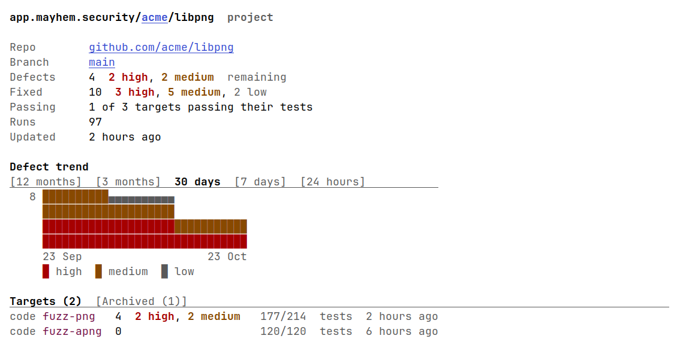

[As text](project.txt)
<!-- /screenshot -->

## Target

A target's latest run, its defect trend folded under `▶ Trend`, and
its latest runs and most severe defects.

<!-- screenshot: (target "acme" "libpng" "fuzz-png") -->

[As text](target.txt)
<!-- /screenshot -->

With `▶ Trend` unfolded:

<!-- screenshot: (target "acme" "libpng" "fuzz-png") :name "target-trend" :press ("▶ Trend") -->
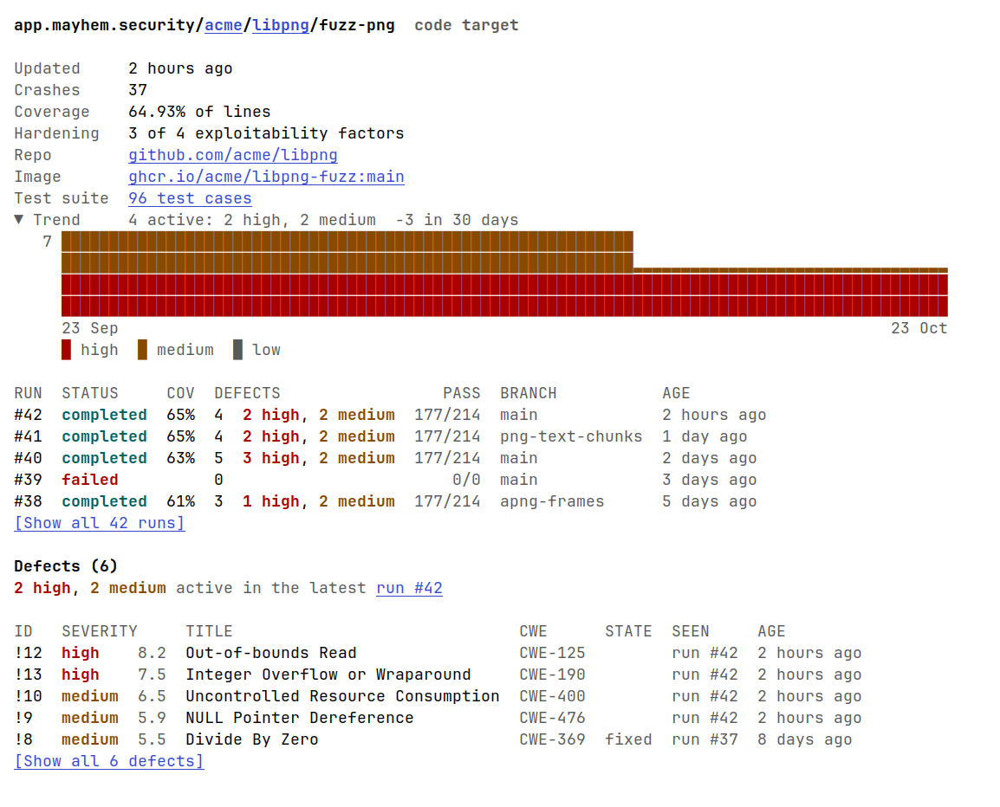

[As text](target-trend.txt)
<!-- /screenshot -->

`[Show all 42 runs]` lists every run, tallied and filterable:

<!-- screenshot: (target-runs "acme" "libpng" "fuzz-png") -->
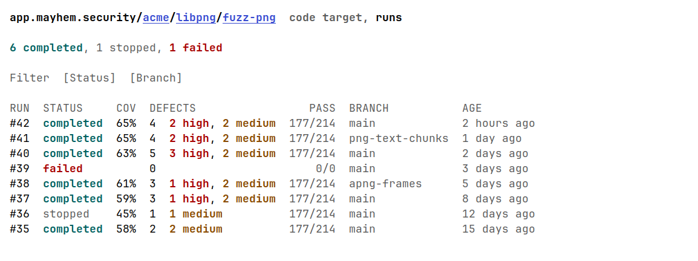

[As text](target-runs.txt)
<!-- /screenshot -->

`[Show all 6 defects]` does the same for its defects:

<!-- screenshot: (target-defects "acme" "libpng" "fuzz-png") -->
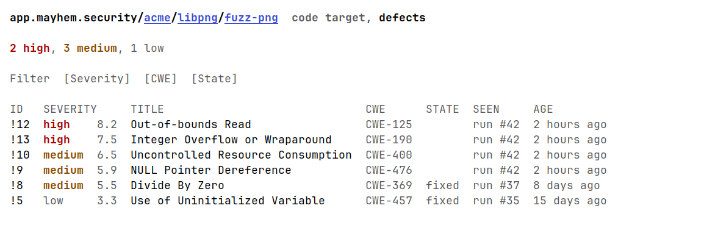

[As text](target-defects.txt)
<!-- /screenshot -->

## Run

A code run: how it went, its coverage, defects and tests.

<!-- screenshot: (run "acme" "libpng" "fuzz-png" 42) -->

[As text](run.txt)
<!-- /screenshot -->

Its event log, from `Log`:

<!-- screenshot: (run-log "acme" "libpng" "fuzz-png" 42) -->
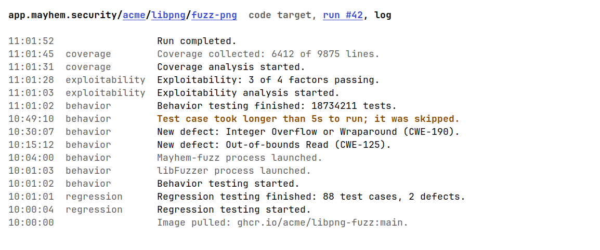

[As text](run-log.txt)
<!-- /screenshot -->

An API run has its endpoints instead:

<!-- screenshot: (run "acme" "billing-api" "api" 7) :name "run-api" -->
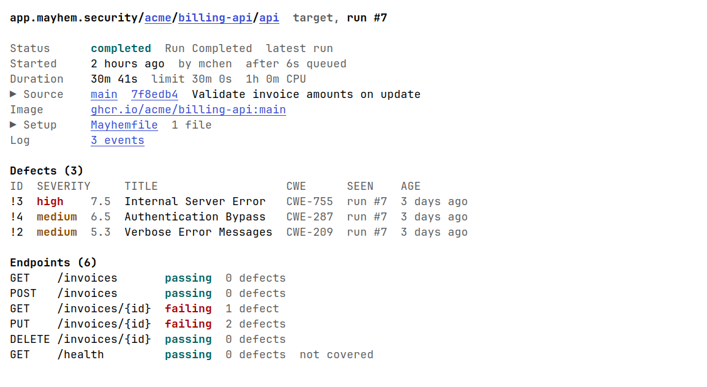

[As text](run-api.txt)
<!-- /screenshot -->

## Defect

A code defect, with the test cases that hit it, how to reproduce one,
and its backtrace.

<!-- screenshot: (defect "acme" "libpng" "fuzz-png" 12 42) :name "defect-code" -->
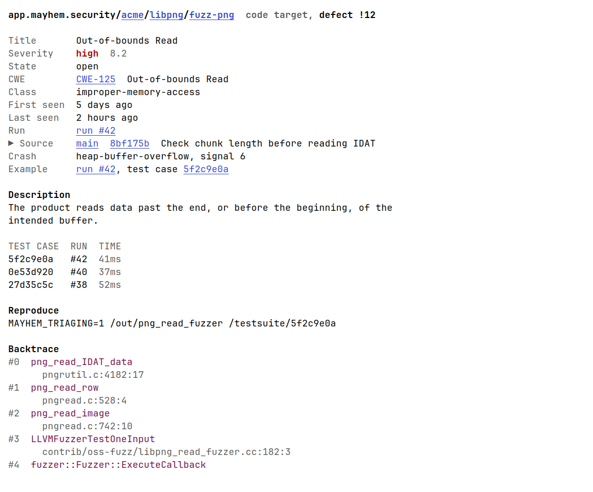

[As text](defect-code.txt)
<!-- /screenshot -->

An API defect, with the HTTP exchange that showed it and the server's
stack trace:

<!-- screenshot: (defect "acme" "billing-api" "api" 3 7) :name "defect-api" -->
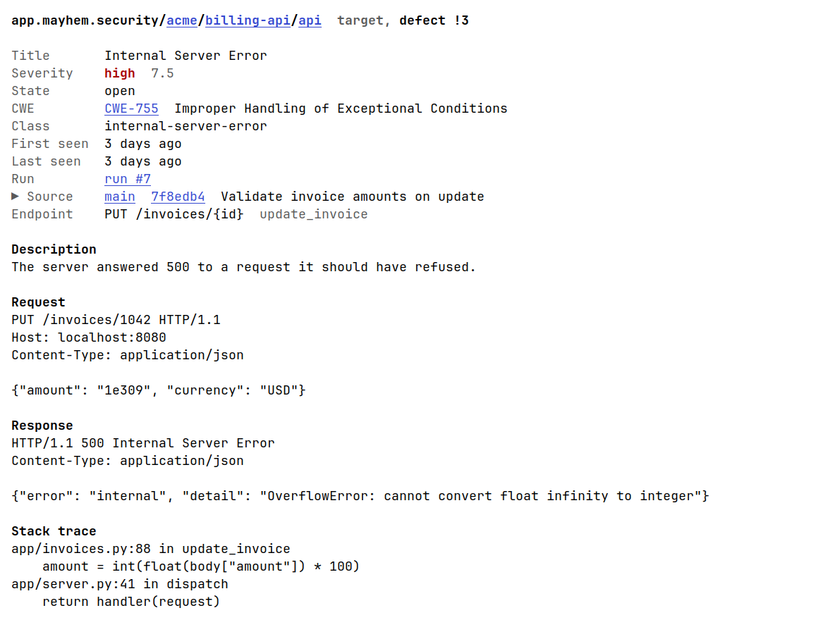

[As text](defect-api.txt)
<!-- /screenshot -->

## Test cases

A run's test suite, the optimized set of its test cases:

<!-- screenshot: (testsuite "acme" "libpng" "fuzz-png" 42) -->
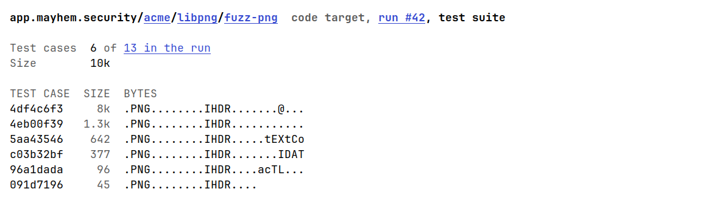

[As text](testsuite.txt)
<!-- /screenshot -->

Every test case of a run, filterable:

<!-- screenshot: (testcases "acme" "libpng" "fuzz-png" 42) -->
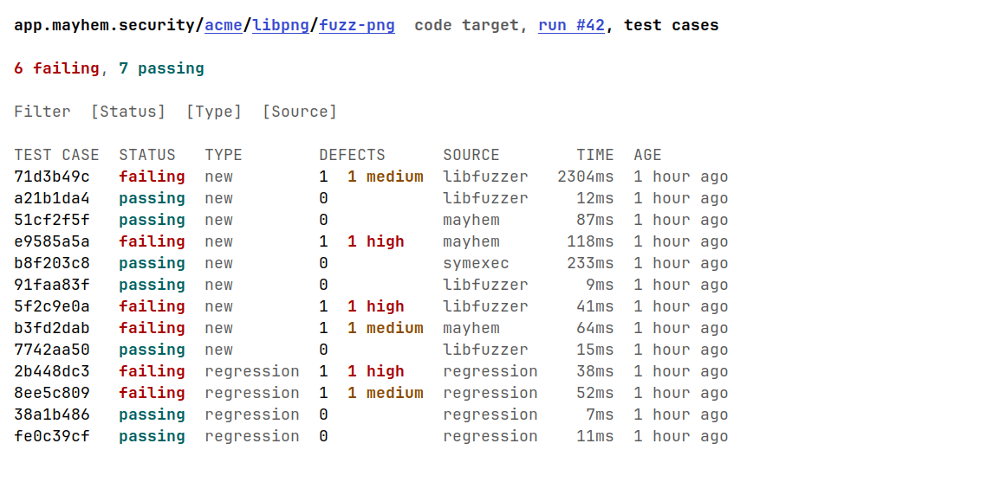

[As text](testcases.txt)
<!-- /screenshot -->

A test case: its defects, how to reproduce it, its bytes, the target's
output and the backtrace.

<!-- screenshot: (testcase "acme" "libpng" "fuzz-png" 42 "5f2c9e0a8b1d4c7e3f6a9b2c5d8e1f4a7b0c3d6e9f2a5b8c1d4e7f0a3b6c9d2e") -->
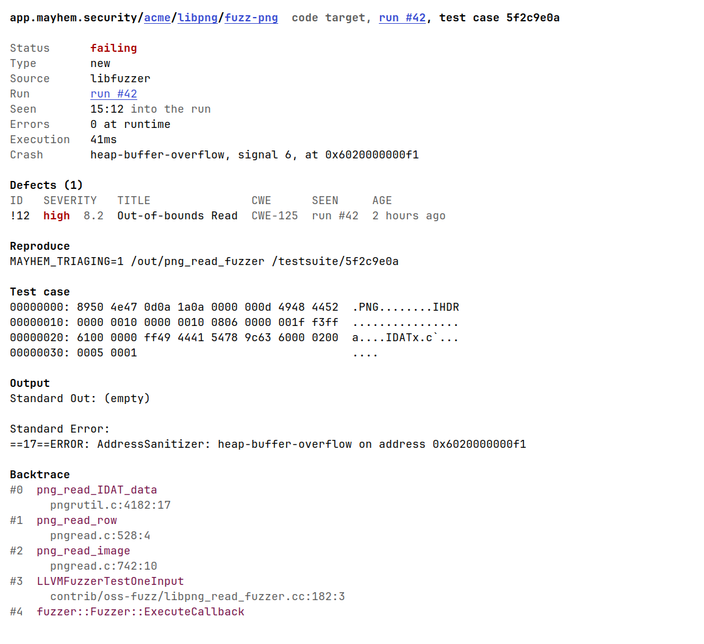

[As text](testcase.txt)
<!-- /screenshot -->

## Updating

`make screenshots` opens each page in a GUI Emacs under a virtual X
display, in a container, and rewrites every shot here: its PNG and its
text, beside this file.  It takes a few seconds.

- **A shot** is a `<!-- screenshot: PAGE ... -->` marker, followed by
  what `make screenshots` writes, up to `<!-- /screenshot -->`.  PAGE
  is `(KIND ARGS...)`, opened by `mayhem-KIND-open`, or `(dashboard)`.
  `:press ("▶ Trend")` presses buttons first, by their text; `:name`
  names its files, by default KIND.  To add a shot, add a marker.
- **The data** is in [test/screenshots/fixtures.el](../../test/screenshots/fixtures.el):
  each resource a page reads, in the shape mayhem.el caches it.  A page
  reading one it lacks fails `make screenshots`, naming it.  Keep it
  made up: no real workspaces, people or hashes.
- **The clock** is frozen at 2026-10-23 12:00 UTC, so ages and charts
  don't change from run to run.
